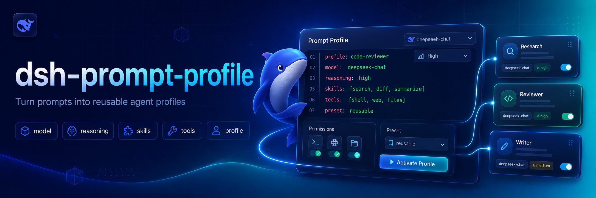

# dsh-prompt-profile



<p align="center">
  <a href="LICENSE"></a>
  <a href="package.json">=24"></a>
  <a href="package.json"></a>
  <a href="package.json"></a>
</p>

<p align="center">
  <a href="https://github.com/awesome-dsh-plugin/awesome-dsh-plugin#development--runtime"></a>
</p>

<p align="center">English | <a href="README.zh.md">中文</a></p>

Reusable Markdown prompt profiles for DeepSeek Harness. A profile can select a provider, model, and reasoning effort for one turn, render command arguments into its body, and restore the previous selection afterward.

## Why this exists 💡

Model choice and review instructions are often repeated across sessions. `dsh-prompt-profile` turns those combinations into small, reusable Markdown profiles that can be invoked for one turn and then leave the Agent's previous model selection intact.

## Features ✨

- Discover profiles from user and project directories, with project profiles taking precedence.
- Substitute positional arguments into profile bodies with shell-style placeholders.
- Select a provider, model, and reasoning effort for one turn.
- Restore the previous Agent selection automatically or opt out per profile.
- List available profiles and invoke nested profiles by slash-separated names.

## Install 📦

```sh
dsh plugin --profile demo add ./dsh-prompt-profile
```

Create a user profile under `~/.dsh/prompt-profiles/` or a project profile under `<repo>/.dsh/prompt-profiles/`:

```markdown
---
description: Deep code review
provider: deepseek
model: deepseek-reasoner
reasoningEffort: high
restore: true
---
Review $1 for correctness, regressions, and missing tests. Extra context: ${@:2}
```

Project profiles override user profiles with the same relative name.

## Use 🚀

```text
/prompt-profile list
/prompt-profile review src/index.ts "focus on cancellation"
```

Nested files use slash-separated names. For example, `.dsh/prompt-profiles/review/security.md` is `review/security`.

Supported placeholders:

| Placeholder | Value |
| --- | --- |
| `$1`, `$2`, … | One positional argument |
| `$@`, `@$`, `$ARGUMENTS` | All arguments |
| `${@:N}` | Arguments from position N |
| `${@:N:L}` | L arguments from position N |

## Frontmatter 🧾

| Field | Required | Meaning |
| --- | --- | --- |
| `description` | No | Text shown by `/prompt-profile list` |
| `provider` | With `model` | Harness provider route |
| `model` | With `provider` | Provider-owned model ID |
| `reasoningEffort` | With `provider` and `model` | Adapter-owned reasoning effort ID |
| `restore` | No | Restore the prior selection after the turn; defaults to `true` |

Omit both `provider` and `model` to use the current agent selection.

## Configure ⚙️

```yaml
- id: dsh-prompt-profile
  name: dsh-prompt-profile
  config:
    userDirectory: ~/.dsh/prompt-profiles
    projectDirectory: .dsh/prompt-profiles
```

## Develop 🧑‍💻

```sh
pnpm install
pnpm run check
```

Commit the generated `lib/` files with source changes so Git installs include the declared package entry before build scripts run.

## Scope 🎯

Version 0.1 intentionally omits prompt chains, loops, skill injection, subagents, worktrees, and best-of-N orchestration. Those features should be added only when Harness extension points can preserve their lifecycle and durable-session semantics.

## License 📄

MIT

## Credits 🙏

The core idea comes from [`pi-prompt-template-model`](https://github.com/nicobailon/pi-prompt-template-model). This first Harness-native release focuses on the smallest useful unit: deterministic discovery, argument substitution, scoped model routing, and restoration.
